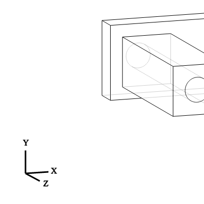
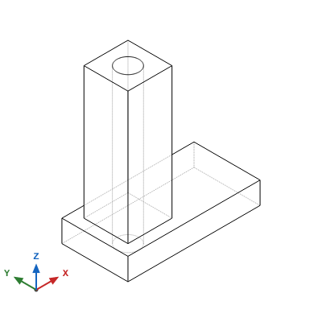
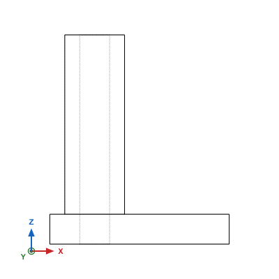
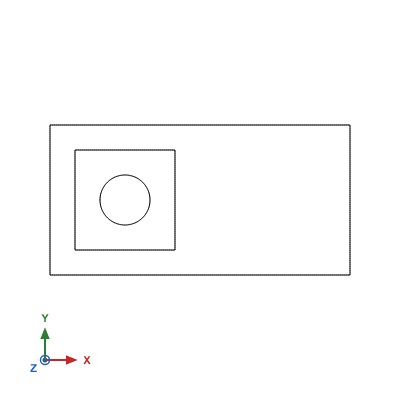
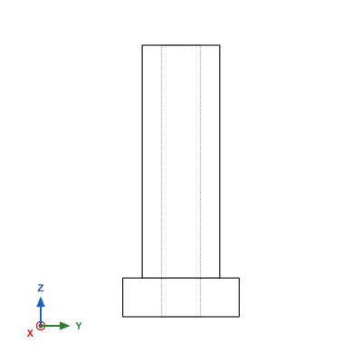

# CadQuery Coordinate Systems and Z-Up CAD Rendering

This document explains the coordinate system convention used by the CadQuery MCP server, the historical quirks of CadQuery's legacy SVG exporter, how they affected multimodal AI reasoning, and the architecture of the **Z-up CAD projection** system with **dynamic coordinate triads**.

---

## 1. The Core Issue: CAD Standards vs. Legacy 2D Graphics

### Mechanical CAD Convention (The Industry Standard)
In mechanical engineering, CAD modeling, 3D printing, and CNC machining (FreeCAD, Fusion 360, SolidWorks, CQ-editor):
- **$Z$-axis is UP** (vertical height, opposing gravity, spindle axis).
- **$XY$-plane is the ground / bed** (the build plate or machine table).
- Looking from the front: **$X$ is Width** (horizontal), **$Z$ is Height** (vertical), and **$Y$ is Depth** (into/out of the screen).

### The CadQuery `getSVG()` Legacy
Early versions of CadQuery introduced `cadquery.occ_impl.exporters.svg.getSVG()` to export 2D SVG vector graphics for web documentation. Unlike CQ-editor (which uses a full 3D viewport with $Z$-up), `getSVG` used OpenCASCADE's 2D hidden line removal (`HLRBRep_Algo`) with an unconstrained camera orientation:

1. **Dominant Z Vector**: The default camera direction was hardcoded to `projectionDir = (-1.75, 1.1, 5.0)`.
2. **OpenCASCADE Fallback Heuristic**: OpenCASCADE's constructor `gp_Ax2(origin, normal)` does not specify a camera "Up" vector. When the viewing direction is dominated by $Z$ ($Z = 5.0$), OpenCASCADE automatically maps:
   - Global **$Y$ as Screen UP**
   - Global **$X$ as Screen Right**
   - Global **$Z$ as Depth** (pointing out of the screen toward the viewer)
3. **Hardcoded Template Widget**: CadQuery's SVG exporter used a static SVG string (`AXES_TEMPLATE`) where the vertical arrow was explicitly labeled **"Y"** and the depth arrow labeled **"Z"**.
4. **Missing Indicators in 2D Views**: In `getSVG()`, the axis widget was only shown if `projectionDir == (-1.75, 1.1, 5)`. In all standard orthographic views (`front`, `top`, `right`, etc.), **no axis indicator was rendered at all**.
5. **90° Tilted Front View**: In `front` view (`projectionDir = (0, -1, 0)`), OpenCASCADE's default heuristic selected $+X$ as screen vertical and $-Z$ as horizontal, rendering front elevations **rotated 90° sideways**.

---

## 2. Visual Comparison

The following renders compare the legacy `getSVG` output against the CadQuery MCP server's Z-up projection on the exact same parametric part:

```python
import cadquery as cq

# Base: 60 (X) x 30 (Y) x 10 (Z) mm
base = cq.Workplane("XY").box(60, 30, 10)
# Vertical tower rising 60 mm along +Z
tower = base.faces(">Z").workplane(centerOption="CenterOfBoundBox").center(-15, 0).rect(20, 20).extrude(60)
# Through hole through top face
result = tower.faces(">Z").workplane().hole(10)
```

### Isometric View

| Legacy `getSVG` Output | New Z-Up CAD Projection |
| :---: | :---: |
|  |  |
| *Part lies on its side; 60 mm height extends towards the viewer; Y points up; model clipped.* | *Base sits flat on XY plane; tower rises vertically along +Z; blue Z arrow points UP.* |

### Front Elevation View

| Legacy `getSVG` Output | New Z-Up CAD Projection |
| :---: | :---: |
|  |  |
| *Model rotated 90° sideways; no axis indicators; clipped off-canvas.* | *Tower upright; dashed hidden lines for vertical bore; X right, Z up, Y depth bullseye.* |

### Orthographic Views (Top and Right)

| Top View ($+Z \rightarrow$ origin) | Right View ($+X \rightarrow$ origin) |
| :---: | :---: |
|  |  |
| *X points Right, Y points Up, Z points towards viewer (bullseye).* | *Y points Right, Z points Up, X points towards viewer (bullseye).* |

---

## 3. Impact on Multimodal AI Assistants (LLMs)

Modern multimodal models (e.g., Claude 3.5/3.7 Sonnet, Gemini 1.5/2.0, GPT-4o) rely heavily on 3D spatial priors trained on physical objects, blueprints, and CAD models:

1. **Hallucinated Aspect Ratios**: When an LLM wrote code for a 70 mm tall tower and saw the legacy isometric render where the tower pointed towards the screen, it often hallucinated that its extrusion depth or aspect ratio was incorrect.
2. **Face Selection Errors**: When asked to add a feature to the "top" face (`>Z`), an LLM looking at the legacy render would see the top face facing the viewer, while the face that visually appeared "on top" was actually `>Y`. This caused models to generate erroneous `faces(">Y")` selectors, corrupting the geometry.
3. **Confusion from 2D Rotations**: Because the legacy front view rotated models 90° with no axis indicator, vision models could not distinguish width from height.

By standardizing all renders to **$Z$-up** with **dynamic RGB triads**, the visual output directly aligns with the LLM's code and standard CAD conventions.

---

## 4. Technical Architecture

The CadQuery MCP server implements its own camera projection and vector math in `cadquery_mcp_server.py`:

### A. Explicit Camera Coordinate System (`_compute_camera_cs`)
Instead of relying on OpenCASCADE's 1-vector constructor, we compute a 3-axis coordinate frame `gp_Ax2(origin, normal, vx)`:

$$\vec{N} = \frac{\text{projectionDir}}{\|\text{projectionDir}\|}$$

For any view where $\vec{N}$ is not collinear with $+Z$:

$$\vec{V}_x = \frac{\vec{Up} \times \vec{N}}{\|\vec{Up} \times \vec{N}\|}, \quad \text{where } \vec{Up} = (0, 0, 1)$$

OpenCASCADE then automatically computes screen vertical ($\vec{V}_y$) as:

$$\vec{V}_y = \vec{N} \times \vec{V}_x$$

This guarantees that:
- $\vec{V}_y \cdot \hat{z} > 0$: The $Z$-axis **always points upward** on the screen.
- Standard elevation views (`front`, `back`, `left`, `right`) maintain $Z$ as vertical and their corresponding ground axis as horizontal.
- For `top` and `bottom` views (where $\vec{N}$ is collinear with $Z$), the camera Up vector automatically falls back to $+Y$ (`(0, 1, 0)`), ensuring $+X$ is Right and $+Y$ is Up.

### B. Dynamic 3D Coordinate Triad (`_generate_dynamic_axes`)
The axis widget is dynamically calculated from the camera's actual projection matrix:
- Each unit vector $\vec{A} \in \{\hat{x}, \hat{y}, \hat{z}\}$ is projected into 2D screen coordinates via dot products:
  $$dx = \vec{A} \cdot \vec{V}_x, \quad dy = \vec{A} \cdot \vec{V}_y$$
- **Color Coding**: Standard CAD triad colors:
  - **Red**: $X$-axis (`#c62828`)
  - **Green**: $Y$-axis (`#2e7d32`)
  - **Blue**: $Z$-axis (`#1565c0`)
- **Depth Detection**: When an axis is aligned with the camera's line of sight ($\sqrt{dx^2 + dy^2} < 0.15$), the server renders a bullseye circle indicator ($\odot$) with its letter label, showing that the axis points into/out of the screen.

### C. Automatic Viewport Centering
The model's bounding box center $((x_{\min} + x_{\max})/2, (y_{\min} + y_{\max})/2)$ is dynamically translated to the center of the viewport canvas, eliminating clipping and awkward margin offsets.
